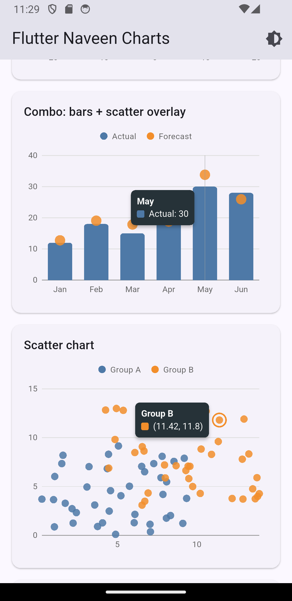
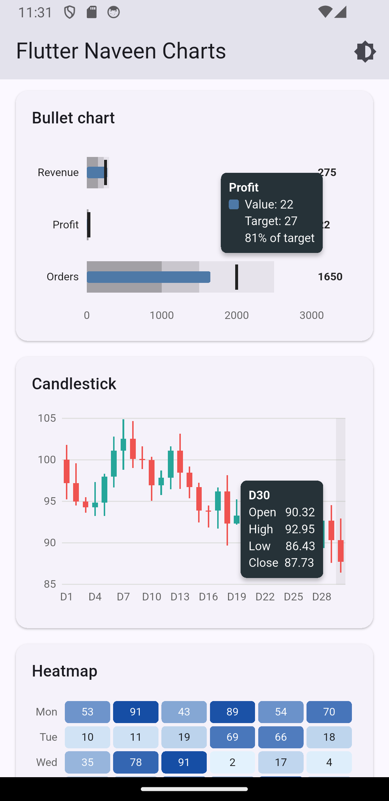
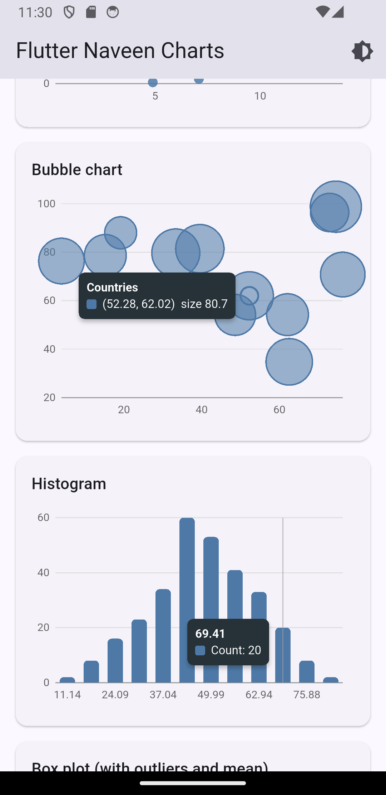
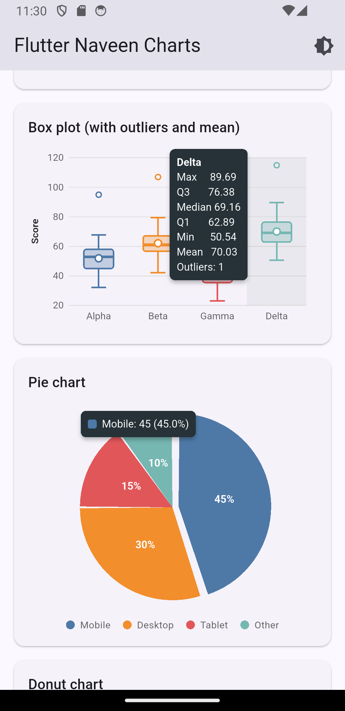
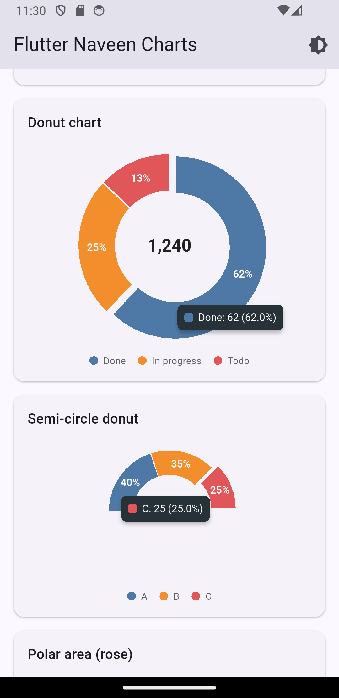
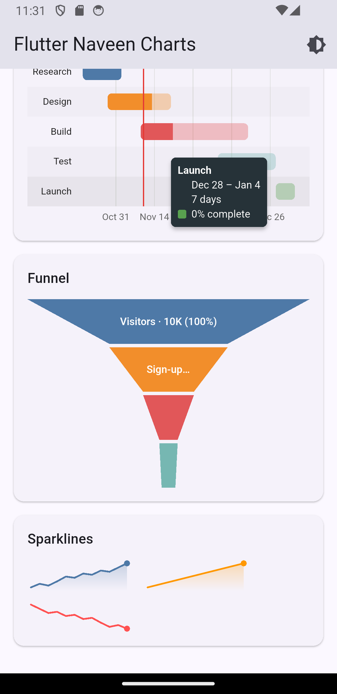

# flutter_naveen_charts

Free charts for Flutter, drawn with `CustomPainter`.
Intro animations, hover / touch tooltips, legends and light/dark themes are built in.

| Chart | Widget |
|---|---|
| Line (curved, stepped, dashed) | `LineChart` + `LineSeries` |
| Area | `AreaChart` + `AreaSeries` |
| Bar (grouped / stacked, negatives) | `BarChart(stacked: …)` + `BarSeries` |
| Combo (bars + lines + scatter) | `CartesianChart` |
| Scatter / Bubble | `ScatterChart` / `BubbleChart` + `ScatterSeries` |
| Histogram | `Histogram(values: …, bins: …)` |
| Pie / Donut | `PieChart` / `DonutChart` |
| Radar | `RadarChart` |
| Gauge | `GaugeChart` |
| Candlestick | `CandlestickChart` |
| Heatmap | `HeatmapChart` |
| Funnel | `FunnelChart` |
| Sparkline | `Sparkline` |


## Charts

| Family | Widgets |
|---|---|
| Cartesian | `LineChart`, `AreaChart`, `StackedAreaChart` (+100 %), `BarChart` (grouped / stacked), `HorizontalBarChart` (+ `.pyramid`), `ScatterChart`, `BubbleChart`, `Histogram`, `CartesianChart` (combo, dual y-axes, zoom & pan) |
| Statistical | `BoxPlotChart`, `ViolinPlot`, `Histogram`, `DensityChart` (KDE), `RidgelineChart`, `EcdfChart`, `QQPlot`, `ErrorBarChart`, `RangeBandChart`, `StripChart` (jitter / beeswarm), `HexbinChart`, `ContourChart`, `ScatterMatrixChart`, `ParallelCoordinatesChart`, `ParetoChart`, `CandlestickChart` |
| Finance | `FinanceChart` (candles, hollow, OHLC, Heikin-Ashi, line, area + indicators), `OhlcChart`, `HeikinAshiChart`, `RenkoChart`, `KagiChart`, `PointFigureChart`, `DepthChart`, `FanChart`, `MarketHeatmapChart`, `CandlestickChart` |
| KPI | `ThermometerChart`, `BatteryChart`, `ScorecardChart`, `DivergingLikertChart`, `RatingStarsChart`, `ProgressRingChart`, `GaugeChart`, `BulletChart`, `Sparkline` |
| Comparison / change | `LollipopChart`, `DumbbellChart`, `SlopeChart`, `BumpChart` |
| Part-to-whole | `PieChart`, `DonutChart` (full or semi-circle), `PolarAreaChart`, `RadialBarChart`, `SunburstChart`, `TreemapChart`, `FunnelChart`, `MarimekkoChart`, `WaffleChart`, `PictogramChart`, `CirclePackingChart`, `IcicleChart`, `NestedPieChart`, `VennChart`, `UpSetChart`, `ParliamentChart` |
| Flow / relations | `SankeyChart`, `AlluvialChart`, `WaterfallChart`, `ChordChart`, `DependencyWheelChart`, `NetworkGraph` (force layout, draggable), `ArcDiagram`, `AdjacencyMatrixChart` |
| Trees | `DendrogramChart`, `RadialTreeChart`, `OrgChart`, `MindMapChart` (all from `TreeNode`), `TreemapChart`, `SunburstChart`, `CirclePackingChart`, `IcicleChart` |
| Comparison / KPI | `RadarChart`, `GaugeChart`, `BulletChart`, `Sparkline` |
| Matrix / time | `HeatmapChart`, `CalendarHeatmap`, `GanttChart`, `StreamGraphChart` |
| Time | `TimelineChart`, `SwimlaneChart`, `SpiralChart`, `ClockChart`, `PolarLineChart`, `HorizonChart`, `BarChartRace` |
| Text | `WordCloud` |
| 3-D (drag to rotate) | `Bar3DChart`, `Scatter3DChart`, `Surface3DChart`, `Pie3DChart` |


## Quick start

```dart
import 'package:flutter_naveen_charts/flutter_naveen_charts.dart';

LineChart(
  xLabels: ['Jan', 'Feb', 'Mar'],
  series: [LineSeries.fromValues(name: 'Sales', values: [12, 18, 15])],
  options: CartesianOptions(
    xAxisTitle: 'Month',
    yAxisTitle: 'Sales (k)',
    referenceLines: [ReferenceLine(16, label: 'Target')],
  ),
)
```

### Dual y-axes

```dart
CartesianChart(
  xLabels: months,
  options: CartesianOptions(
    yAxisTitle: 'Revenue',
    secondaryAxisTitle: 'Conversion',
    secondaryYFormat: (v) => '${v.toStringAsFixed(0)}%',
  ),
  series: [
    BarSeries.fromValues(name: 'Revenue', values: revenue),
    LineSeries.fromValues(name: 'Conversion', values: conv, secondaryAxis: true),
  ],
)
```

### Zoom & pan

`CartesianOptions(zoomable: true)`: pinch or mouse wheel to zoom, drag to pan, double-tap to reset
(`maxZoom` sets the limit). A zoomable chart captures drag gestures, so keep it out of a
horizontally scrolling parent.

### Hierarchies (treemap, sunburst)

```dart
const tree = [
  HierarchyNode('Electronics', children: [
    HierarchyNode('Phones', value: 120),
    HierarchyNode('Laptops', value: 90),
  ]),
  HierarchyNode('Toys', value: 50),
];
TreemapChart(nodes: tree);
SunburstChart(roots: tree);
```

### Sankey

```dart
SankeyChart(
  nodes: [SankeyNode('a', label: 'Search'), SankeyNode('b', label: 'Landing')],
  links: [SankeyLink('a', 'b', 40)],
)
```

### Box plot

```dart
BoxPlotChart(data: [
  BoxPlotStats.fromValues('Group A', samplesA),            // from raw samples
  BoxPlotStats(label: 'B', min: 1, q1: 2, median: 3, q3: 4, max: 6), // or precomputed
])
```

### Chord, network, word cloud

```dart
ChordChart(labels: ['A', 'B', 'C'], matrix: [[0, 5, 2], [3, 0, 4], [1, 2, 0]]);

NetworkGraph(
  nodes: [NetworkNode('a', group: 0), NetworkNode('b', group: 1, size: 3)],
  edges: [NetworkEdge('a', 'b', weight: 2)],
  directed: true,
);

WordCloud(words: [WordEntry('Flutter', 100), WordEntry('Dart', 70)]);
```

### 3-D charts

```dart
Bar3DChart(categories: ['Q1', 'Q2'], seriesNames: ['North', 'South'],
    values: [[30, 40], [20, 25]]);                      // values[series][category]
Surface3DChart(values: grid);                           // grid[row][col]
Scatter3DChart(points: [Point3D(1, 2, 3, group: 0)]);
Pie3DChart(slices: [PieSlice('A', 60), PieSlice('B', 40)]);
```

Drag to rotate (pie: spin and tilt), double-tap to reset. Tooltips work on every 3-D chart.
The projection helpers (`Chart3DView`, `Projector3D`, `shade`, `rampColor`) are exported for custom 3-D charts.

### KPI charts

```dart
ThermometerChart(value: 36.6, min: 30, max: 42, unit: '°C', target: 37,
    secondaryConvert: (c) => c * 9 / 5 + 32);                  // °C left, °F right
BatteryChart(level: 45, segments: 5, charging: true);
ScorecardChart(columns: 2, kpis: [
  KpiItem('Revenue', 128400, previous: 114200, prefix: '\$', target: 150000, trend: [90, 99, 110, 128]),
  KpiItem('Churn', 3.2, previous: 3.9, suffix: '%', higherIsBetter: false),
]);
DivergingLikertChart(levels: ['Disagree', 'Neutral', 'Agree'], questions: [LikertQuestion('Q1', [5, 10, 30])]);
RatingStarsChart(rating: 4.3, ratingCount: 1284, distribution: [32, 58, 130, 410, 654]);
ProgressRingChart(value: 132, max: 100, label: 'Quota', previous: 110);   // goes past the goal with a second lap
```

`ScorecardChart` is built from normal widgets, so it wraps and sizes itself. Helpers `likertNet`,
`kpiDeltaPercent` and `starPath` are exported.

### Time charts

```dart
TimelineChart(events: [TimelineEvent(DateTime(2024, 5, 1), 'Launch', description: 'v1', end: DateTime(2024, 8, 1))]);
SwimlaneChart(lanes: ['Design', 'Dev'], items: [SwimlaneItem('Dev', start, end: end, label: 'API'), SwimlaneItem('Dev', date, label: 'Freeze')]);
SpiralChart(values: monthly, period: 12, phaseLabels: monthNames);   // one turn = one year
ClockChart(series: [ClockSeries('Weekday', hourly24)], markerIndex: DateTime.now().hour);
PolarLineChart(labels: months, series: [PolarSeries('2025', temps)]);
HorizonChart(series: [HorizonSeries('Sensor 1', values)], bands: 3);
BarChartRace(names: countries, frames: [BarRaceFrame('2010', [..]), BarRaceFrame('2011', [..])], topN: 8);
```

`niceTimeTicks(lo, hi)` (calendar-aligned axis ticks) is exported for your own date charts.

### Relations and trees

```dart
const org = TreeNode('CEO', subtitle: 'Ada', children: [
  TreeNode('CTO', subtitle: 'Linus', children: [TreeNode('Mobile'), TreeNode('Web')]),
  TreeNode('CFO'),
]);
OrgChart(root: org, initialCollapseDepth: 2);          // tap a card to collapse / expand
MindMapChart(root: org);                                // tap a node to fold its branch
RadialTreeChart(root: org);
DendrogramChart(root: cluster);                         // uses TreeNode.height as merge distance

ArcDiagram(nodes: nodes, edges: edges, order: ArcNodeOrder.group);
AdjacencyMatrixChart(nodes: nodes, edges: edges, order: AdjacencyOrder.group);
DependencyWheelChart(nodes: modules, edges: dependencies);
AlluvialChart(stageTitles: ['2023', '2024'], categories: [['Free', 'Paid'], ['Free', 'Paid', 'Churned']],
    flows: [AlluvialFlow(0, 'Free', 'Paid', 12)]);
```

Nodes and edges are the same `NetworkNode` / `NetworkEdge` types used by `NetworkGraph`.

### Part-to-whole charts

```dart
WaffleChart(slices: [PieSlice('Mobile', 48), PieSlice('Desktop', 33)], total: 100);
PictogramChart(unitValue: 10, items: [PictogramItem('Seattle', 62, icon: Icons.person)]);
CirclePackingChart(nodes: tree);              // HierarchyNode forest, same data as treemap / sunburst
IcicleChart(nodes: tree, horizontal: true);
NestedPieChart(rings: [innerSlices, outerSlices], ringNames: ['2024', '2026']);
VennChart(sets: [VennSet('A', 80), VennSet('B', 45)], overlaps: [VennOverlap([0, 1], 18)]);
UpSetChart.fromSets(sets: {'Web': {1, 2, 3}, 'AI': {2, 3, 4}});   // or the plain constructor with precomputed sizes
ParliamentChart(parties: [ParliamentParty('Labour', 204, color: Colors.red)]);
```

The Venn chart supports 1 to 3 sets (circle areas follow the sizes; two-set overlaps are exact). Use `UpSetChart` when you have more.

### Market heatmap

```dart
MarketHeatmapChart(
  tiles: [
    MarketTile('BTC', 100, -0.13, name: 'Bitcoin', price: 64210),   // symbol, volume, % change
    MarketTile('ETH', 55, -0.42),
    MarketTile('BNB', 14, 0.41),
  ],
  maxMove: 5,                       // % move that gets the darkest colour
  showLegend: true,
  onTileTap: (tile) => print(tile.symbol),
);
```

Tile area = volume, colour = price change (green up / red down, darker = bigger move). Options: `title`,
`caption`, `gap`, `tileRadius`, `outerRadius` (rounded frame), `upColors` / `downColors` ramps,
`neutralColor`, `showArrows`, `changeFormat`, `volumeFormat`, `priceFormat`. `marketChangeColor()` and
`layoutMarketTiles()` are exported for custom use.

### Finance charts

```dart
FinanceChart(
  candles: bars,                       // List<Candle>(label, open, high, low, close, volume)
  type: FinanceChartType.hollowCandlestick,
  visibleBars: 80,                     // start zoomed on the latest 80 bars
  showVolume: true,
  overlays: const [FinanceOverlay.sma(20), FinanceOverlay.ema(50), FinanceOverlay.bollinger()],
  panels: const [FinancePanel.rsi(), FinancePanel.macd()],
  logScale: false,
  upColor: Colors.green,
  downColor: Colors.red,
);

RenkoChart(prices: closes, brickSize: 2);
KagiChart(prices: closes, reversalPercent: 3);
PointFigureChart(prices: closes, boxSize: 1, reversal: 3);
DepthChart(bids: [DepthLevel(99.9, 12)], asks: [DepthLevel(100.1, 9)]);
FanChart.fromSigma(history: past, median: path, sigma: sigmas, levels: [0.95, 0.8, 0.5]);
```

`FinanceChart` drag / pinch / wheel to zoom and pan, double-tap to reset, a crosshair with price tag and a
tooltip with O/H/L/C, change, volume and indicator values. The transforms (`renkoBricks`, `kagiLines`,
`pointFigureColumns`) and indicators (`sma`, `ema`, `bollinger`, `rsi`, `macd`, `heikinAshi`, `atr`) are exported.

### Statistical charts

```dart
DensityChart(showHistogram: true, showRug: true,
    series: [DensitySeries('Control', a), DensitySeries('Treated', b)]);
RidgelineChart(data: [RidgeData('Jan', janTemps), RidgeData('Jul', julTemps)]);
QQPlot(sample: values);                                   // vs normal; or reference: other
StripChart(layout: StripLayout.beeswarm, groups: [StripGroup('A', a)]);
HexbinChart(points: [Offset(x, y), ...], binRadius: 14);
ContourChart(values: grid, xMin: -3, xMax: 3, yMin: -3, yMax: 3, levels: 9);
ScatterMatrixChart(names: ['x', 'y', 'z'], columns: [xs, ys, zs], groups: groups);
ParallelCoordinatesChart(dimensions: dims, rows: rows, groups: groups);
ParetoChart(items: [ParetoItem('Scratches', 120), ParetoItem('Dents', 85)]);
```

Statistics helpers (`quantile`, `kde`, `normInv`, `silverman`, `mean`, `stdDev`) and the frame helpers
(`paintFrame`, `paintHFrame`) are exported, so you can build further x/y charts in a few lines.

## Customisation

* **`CartesianOptions`** (line / area / bar / scatter / combo): `title`, `xAxisTitle`, `yAxisTitle`,
  `secondaryAxisTitle`, `gridMode` (none / horizontal / vertical / both), `dashedGrid`, `showLegend`,
  `showValueLabels`, `referenceLines`, `zoomable`, `maxZoom`, `yFormat`, `xFormat`, `secondaryYFormat`,
  `yMin` / `yMax`, `secondaryYMin` / `secondaryYMax`, `barWidthFactor`, `interactive`.
* **Series**: colour, `curved`, `stepped`, `dashed`, `fill`, `strokeWidth`, `showMarkers`, `markerRadius`,
  `cornerRadius` (bars), `markerSize` / `maxBubbleRadius` (scatter), `secondaryAxis`.
* **Pie / donut**: `donut`, `holeRatio`, `centerText`, `showPercent`, `startAngle`, `sweepAngle`.
* **Gauge**: `min`, `max`, `segments`, `color`, `strokeWidth`, `unit`, `label`.
* **Radial bar**: `maxValue`, `startAngle`, `sweepAngle`, `ringWidth`, `ringGap`, `centerText`.
* **Sankey**: `nodeWidth`, `nodePadding`, `linkOpacity`, per-node and per-link colours.
* **Waterfall**: `positiveColor`, `negativeColor`, `totalColor`, `showConnectors`.
* **Treemap**: `padding`, `cornerRadius`, `showValues`. **Sunburst**: `holeRatio`, `centerLabel`.
* **Chord**: `padAngle`, `arcWidth`, `ribbonOpacity`, `colors`. **Network**: `directed`, `draggable`, `layoutIterations`, `seed`, node `size` / `group` / `color`, edge `weight`.
* **Word cloud**: `minFontSize`, `maxFontSize`, `rotateProbability`, `padding`, `seed`, `fontWeight`.
* **Violin**: `bandwidth`, `points`, `showBox`, `showMedian`, `widthFactor`. **Streamgraph**: `baseline` (silhouette / wiggle), `curved`. **Marimekko**: `gap`, `showPercentLabels`, `colors`.
* **3-D**: `initialYaw`, `initialPitch`, `rotatable`; bar `barSize`, `showValueLabels`; scatter `pointRadius`, `showDropLines`; surface `colors` ramp, `showWireframe`, `showColorBar`; pie `thickness`, `initialTilt`, `explodeOnHover`.
* **KPI**: thermometer `zones`, `target`, `secondaryConvert`, `ticks`, `minorTicks`; battery `segments`, `vertical`, `charging`, `lowThreshold` / `midThreshold`, colours; scorecard `columns`, `deltaMode`, `goodColor` / `badColor`, `cardRadius`, per-KPI `higherIsBetter`, `target`, `trend`, `prefix` / `suffix`; Likert `colors`, `sortByNet`, `showNet`, `showPercent`; rating `maxStars`, `distribution`, `starColor`; ring `thickness`, `segments`, `zones`, `previous`.
* **Time**: timeline `vertical`, `evenSpacing`, `maxCardWidth`, `cardHeight`, `dateFormat`; swimlane `rowHeight`, `showToday`; spiral `style`, `colors`, `innerRadiusRatio`, `phaseLabels`; clock `style`, `labelEvery`, `markerIndex`, `showPeak`, `centerText`; polar line `curved`, `fill`, `minValue` / `maxValue`, `rings`; horizon `bands`, `baseline`, `sharedScale`, `positiveColor` / `negativeColor`; race `topN`, `secondsPerFrame`, `autoPlay`, `loop`, `showControls`, `colors`.
* **Relations**: arc `order`, `directed`, `rotateLabels`, `minArcWidth` / `maxArcWidth`; alluvial `nodeWidth`, `nodePadding`, `flowOpacity`, per-flow `color`; dependency wheel `padAngle`, `arcWidth`, `ribbonOpacity`; dendrogram `orientation`, `colorBranches`, `showInternalLabels`, `distanceFormat`; radial tree `startAngle`, `showInternalLabels`; org chart `nodeWidth`, `nodeHeight`, `hGap`, `vGap`, `collapsible`, `initialCollapseDepth`; mind map `levelGap`, `rowHeight`, `collapsible`; adjacency matrix `order`, `directed`, `showValues`, `showGroupBars`, `colors`.
* **Part-to-whole**: waffle `rows`, `columns`, `total`, `shape`, `gap`, `fillFromBottom`, `byColumns`, `emptyColor`; pictogram `unitValue`, `icon` (per item too), `rowHeight`, `iconGap`; circle packing `padding`, `showLabels`; icicle `horizontal`, `gap`, `cornerRadius`; nested pie `holeRatio`, `ringGap`, `ringNames`; Venn `fillOpacity`, `showSetLabels`, `showRegionValues`; UpSet `maxIntersections`, `sortBy`, `barColor`, `setBarColor`; parliament `rows`, `showMajorityLine`, `centerText`.
* **Finance**: `type`, `overlays` (SMA / EMA / Bollinger with period, colour, width), `panels` (RSI / MACD with periods, levels, colour, weight), `showVolume`, `upColor` / `downColor`, `lineColor`, `showLastPrice`, `showCrosshair`, `logScale`, `priceFormat`, `volumeFormat`, `visibleBars`, `maxZoom`, `zoomable`. Renko `brickSize`, `hollowUp`; Kagi `reversalAmount` / `reversalPercent`, `thickColor` / `thinColor`, line widths; P&F `boxSize`, `reversal`, `xColor` / `oColor`, `showGrid`; depth `bidColor` / `askColor`, `fillOpacity`, `showMidPrice`, `showSpread`; fan `bands`, `bandOpacity`, `showMedian`, `showNowLine`, `FanChart.fromSigma(levels: ...)`.
* **Statistical**: `bandwidth`, `points`, `showHistogram`, `showRug` (density); `overlap`, `showMedian` (ridgeline); `complementary`, `showPoints` (ECDF); `reference`, `showLine` (QQ); `layout`, `showMean`, `widthFactor` (strip); `binRadius`, `colors` (hexbin); `levels`, `levelValues`, `filled`, `showLines` (contour); `asBars`, `errors` / `errorsLow` / `errorsHigh` (error bars); `low2` / `high2` inner band (range band); `valuesAreRanks` (bump); `colorByDirection` (slope); `sortByGap` (dumbbell); `invertedDimensions`, `curved` (parallel); `showHistograms`, `bins` (scatter matrix).
* **Heatmaps**: `lowColor`, `highColor`, `emptyColor`, `showValues`, `weeks`, `cellGap`.
* **Every chart**: `theme` (a `ChartTheme`: palette, grid / axis / text colours, tooltip styles), `aspectRatio`,
  `animationDuration` (`Duration.zero` disables the intro animation), `valueFormat` / `yFormat` formatters.
* **Your own chart**: `ChartCanvas(builder: (progress, pointer) => MyPainter(...))` gives you the animation
  value (0..1) and the hover / touch position; helpers `NiceScale`, `paintText`, `paintTooltip`,
  `buildLinePath` and `sectorPath` are exported.

```dart
final brand = ChartTheme.light().copyWith(palette: [Colors.teal, Colors.amber, Colors.pink]);
BarChart(theme: brand, series: [...])
```


## Screenshots

<table>
  <tr>
    <td></td>
    <td></td>
    <td></td>
  </tr>
  <tr>
    <td></td>
    <td></td>
    <td></td>
  </tr>
  <tr>
    <td></td>
    <td></td>
    <td></td>
  </tr>
  <tr>
    <td></td>
    <td></td>
    <td></td>
  </tr>
  <tr>
    <td></td>
    <td></td>
    <td></td>
  </tr>
  <tr>
    <td></td>
    <td></td>
    <td></td>
  </tr>
</table>

DonutChart(centerText: '1,240', slices: [PieSlice('Done', 62), PieSlice('Todo', 38)])

GaugeChart(value: 72, unit: '%', segments: [
  GaugeSegment(50, Colors.green), GaugeSegment(80, Colors.orange), GaugeSegment(100, Colors.red),
])
```


Numeric x axes: use `LineSeries(name: 'x', points: [DataPoint(0.5, 3), DataPoint(2.1, 7)])`.
Bubbles: `DataPoint(x, y, size: 40)`.


Any help or suggestion contact me naveensheoran1000@gmail.com or telegram @NaveenSheoran777

For Support : USDT  <Tron Network>  TQyNG1GkMdYuEFNoY8JHVujmv8yGTcX2HS

