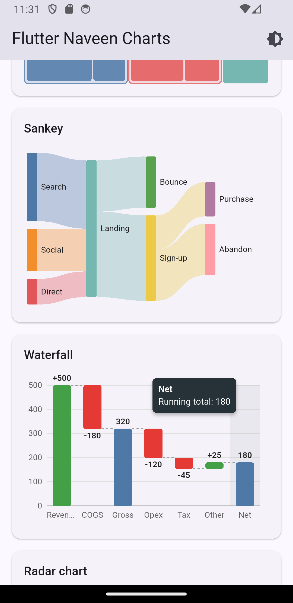
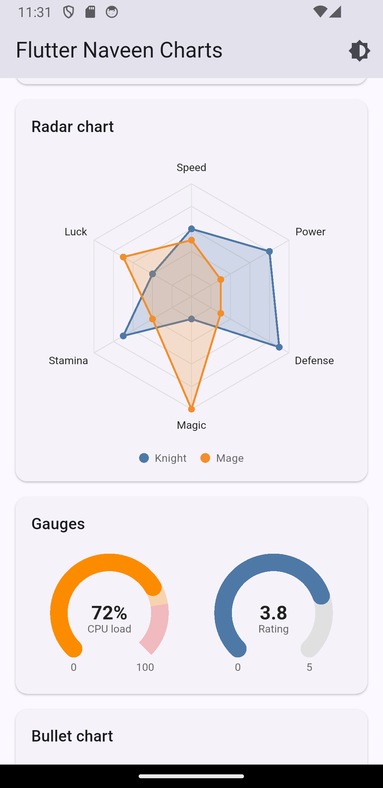
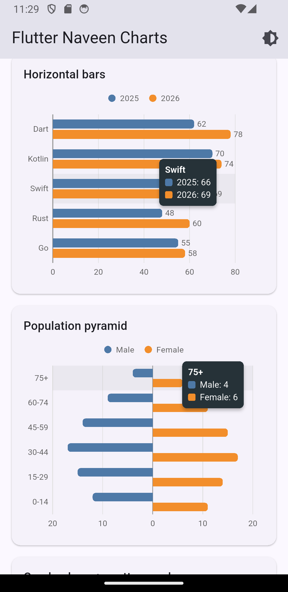
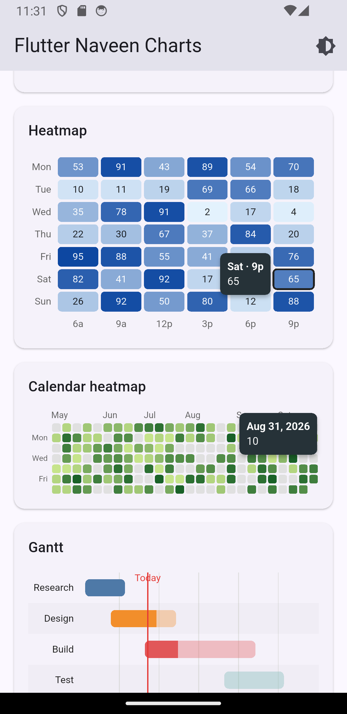
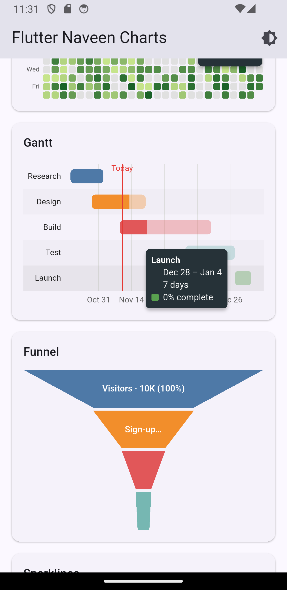
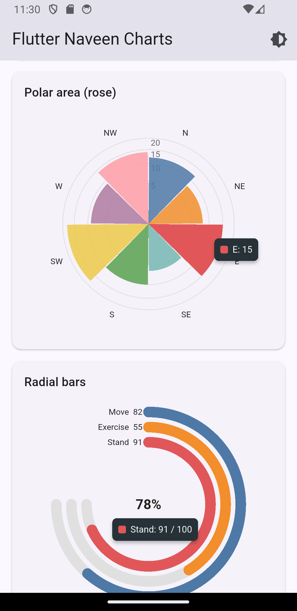
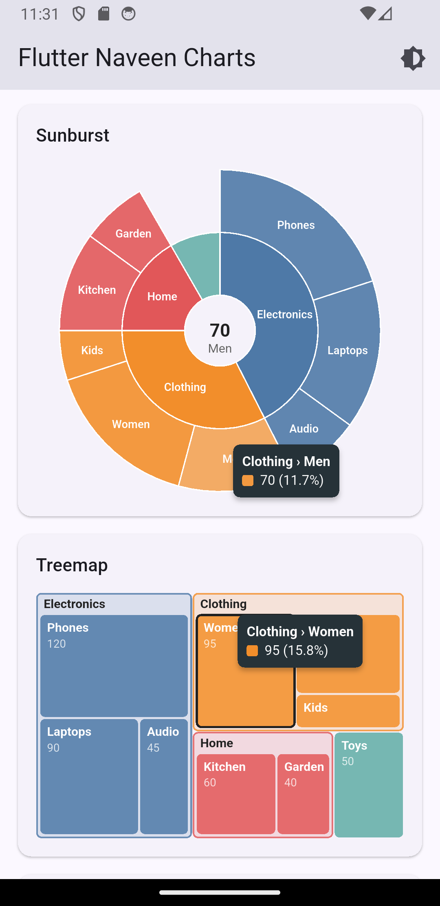
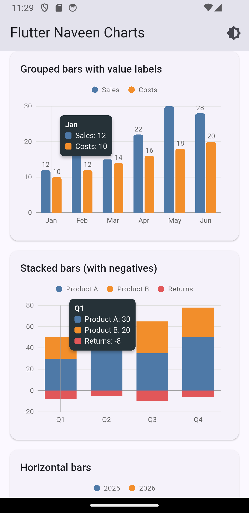
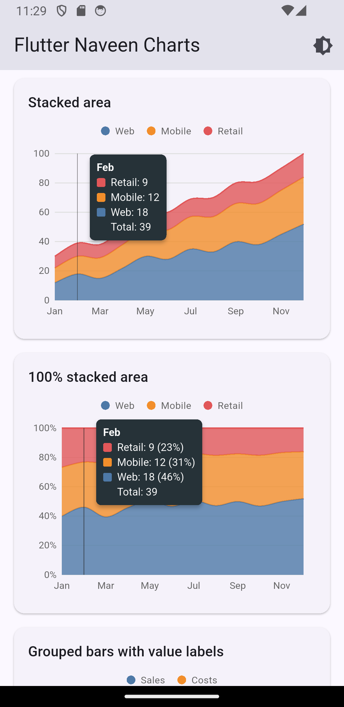
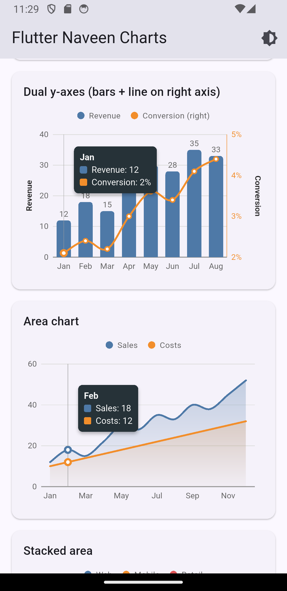

# flutter_naveen_charts

Free charts for Flutter, drawn with `CustomPainter`.
Intro animations, hover / touch tooltips, legends and light/dark themes are built in.

| Chart | Widget |
|---|---|
| Line (curved, stepped, dashed) | `LineChart` + `LineSeries` |
| Area | `AreaChart` + `AreaSeries` |
| Bar (grouped / stacked, negatives) | `BarChart(stacked: …)` + `BarSeries` |
| Combo (bars + lines + scatter) | `CartesianChart` |
| Scatter / Bubble | `ScatterChart` / `BubbleChart` + `ScatterSeries` |
| Histogram | `Histogram(values: …, bins: …)` |
| Pie / Donut | `PieChart` / `DonutChart` |
| Radar | `RadarChart` |
| Gauge | `GaugeChart` |
| Candlestick | `CandlestickChart` |
| Heatmap | `HeatmapChart` |
| Funnel | `FunnelChart` |
| Sparkline | `Sparkline` |

## Charts (27)

| Family | Widgets |
|---|---|
| Cartesian | `LineChart`, `AreaChart`, `StackedAreaChart` (+100 %), `BarChart` (grouped / stacked), `HorizontalBarChart` (+ `.pyramid`), `ScatterChart`, `BubbleChart`, `Histogram`, `CartesianChart` (combo, dual y-axes, zoom & pan) |
| Statistical | `BoxPlotChart` (quartiles, whiskers, outliers, mean), `Histogram`, `CandlestickChart` |
| Part-to-whole | `PieChart`, `DonutChart` (full or semi-circle), `PolarAreaChart`, `RadialBarChart`, `SunburstChart`, `TreemapChart`, `FunnelChart` |
| Flow | `SankeyChart`, `WaterfallChart` |
| Comparison / KPI | `RadarChart`, `GaugeChart`, `BulletChart`, `Sparkline` |
| Matrix / time | `HeatmapChart`, `CalendarHeatmap`, `GanttChart` |

## Quick start

```dart
import 'package:flutter_naveen_charts/flutter_naveen_charts.dart';

LineChart(
  xLabels: ['Jan', 'Feb', 'Mar'],
  series: [LineSeries.fromValues(name: 'Sales', values: [12, 18, 15])],
  options: CartesianOptions(
    xAxisTitle: 'Month',
    yAxisTitle: 'Sales (k)',
    referenceLines: [ReferenceLine(16, label: 'Target')],
  ),
)
```

### Dual y-axes

```dart
CartesianChart(
  xLabels: months,
  options: CartesianOptions(
    yAxisTitle: 'Revenue',
    secondaryAxisTitle: 'Conversion',
    secondaryYFormat: (v) => '${v.toStringAsFixed(0)}%',
  ),
  series: [
    BarSeries.fromValues(name: 'Revenue', values: revenue),
    LineSeries.fromValues(name: 'Conversion', values: conv, secondaryAxis: true),
  ],
)
```

### Zoom & pan

`CartesianOptions(zoomable: true)`: pinch or mouse wheel to zoom, drag to pan, double-tap to reset
(`maxZoom` sets the limit). A zoomable chart captures drag gestures, so keep it out of a
horizontally scrolling parent.

### Hierarchies (treemap, sunburst)

```dart
const tree = [
  HierarchyNode('Electronics', children: [
    HierarchyNode('Phones', value: 120),
    HierarchyNode('Laptops', value: 90),
  ]),
  HierarchyNode('Toys', value: 50),
];
TreemapChart(nodes: tree);
SunburstChart(roots: tree);
```

### Sankey

```dart
SankeyChart(
  nodes: [SankeyNode('a', label: 'Search'), SankeyNode('b', label: 'Landing')],
  links: [SankeyLink('a', 'b', 40)],
)
```

### Box plot

```dart
BoxPlotChart(data: [
  BoxPlotStats.fromValues('Group A', samplesA),            // from raw samples
  BoxPlotStats(label: 'B', min: 1, q1: 2, median: 3, q3: 4, max: 6), // or precomputed
])
```

## Customisation

* **`CartesianOptions`** (line / area / bar / scatter / combo): `title`, `xAxisTitle`, `yAxisTitle`,
  `secondaryAxisTitle`, `gridMode` (none / horizontal / vertical / both), `dashedGrid`, `showLegend`,
  `showValueLabels`, `referenceLines`, `zoomable`, `maxZoom`, `yFormat`, `xFormat`, `secondaryYFormat`,
  `yMin` / `yMax`, `secondaryYMin` / `secondaryYMax`, `barWidthFactor`, `interactive`.
* **Series**: colour, `curved`, `stepped`, `dashed`, `fill`, `strokeWidth`, `showMarkers`, `markerRadius`,
  `cornerRadius` (bars), `markerSize` / `maxBubbleRadius` (scatter), `secondaryAxis`.
* **Pie / donut**: `donut`, `holeRatio`, `centerText`, `showPercent`, `startAngle`, `sweepAngle`.
* **Gauge**: `min`, `max`, `segments`, `color`, `strokeWidth`, `unit`, `label`.
* **Radial bar**: `maxValue`, `startAngle`, `sweepAngle`, `ringWidth`, `ringGap`, `centerText`.
* **Sankey**: `nodeWidth`, `nodePadding`, `linkOpacity`, per-node and per-link colours.
* **Waterfall**: `positiveColor`, `negativeColor`, `totalColor`, `showConnectors`.
* **Treemap**: `padding`, `cornerRadius`, `showValues`. **Sunburst**: `holeRatio`, `centerLabel`.
* **Heatmaps**: `lowColor`, `highColor`, `emptyColor`, `showValues`, `weeks`, `cellGap`.
* **Every chart**: `theme` (a `ChartTheme`: palette, grid / axis / text colours, tooltip styles), `aspectRatio`,
  `animationDuration` (`Duration.zero` disables the intro animation), `valueFormat` / `yFormat` formatters.
* **Your own chart**: `ChartCanvas(builder: (progress, pointer) => MyPainter(...))` gives you the animation
  value (0..1) and the hover / touch position; helpers `NiceScale`, `paintText`, `paintTooltip`,
  `buildLinePath` and `sectorPath` are exported.

```dart
final brand = ChartTheme.light().copyWith(palette: [Colors.teal, Colors.amber, Colors.pink]);
BarChart(theme: brand, series: [...])
```


Screenshots
               
   
DonutChart(centerText: '1,240', slices: [PieSlice('Done', 62), PieSlice('Todo', 38)])

GaugeChart(value: 72, unit: '%', segments: [
  GaugeSegment(50, Colors.green), GaugeSegment(80, Colors.orange), GaugeSegment(100, Colors.red),
])
```


Numeric x axes: use `LineSeries(name: 'x', points: [DataPoint(0.5, 3), DataPoint(2.1, 7)])`.
Bubbles: `DataPoint(x, y, size: 40)`.


Any help or suggestion contact me naveensheoran1000@gmail.com or telegram @NaveenSheoran777

For Support : USDT  <Tron Network>  TQyNG1GkMdYuEFNoY8JHVujmv8yGTcX2HS

