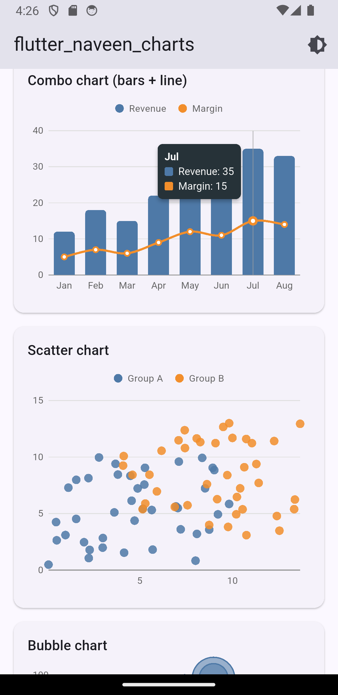
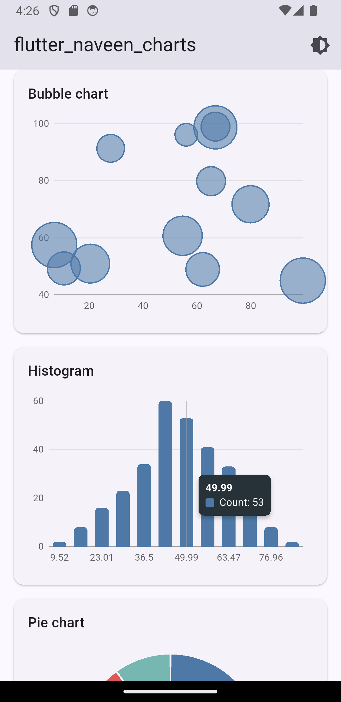
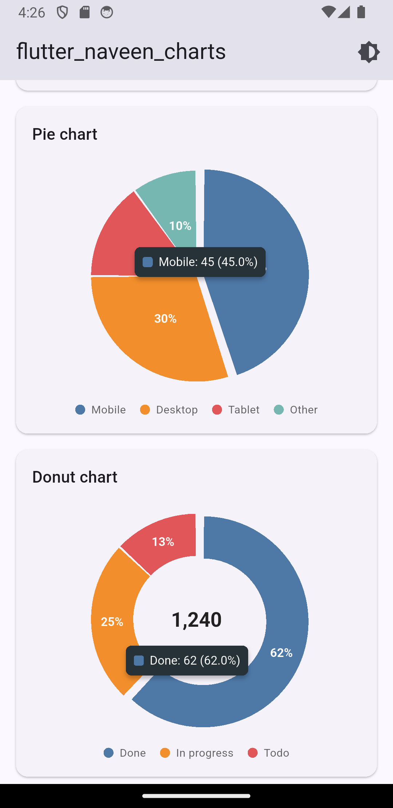
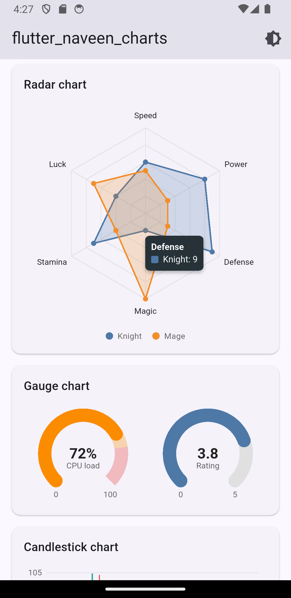
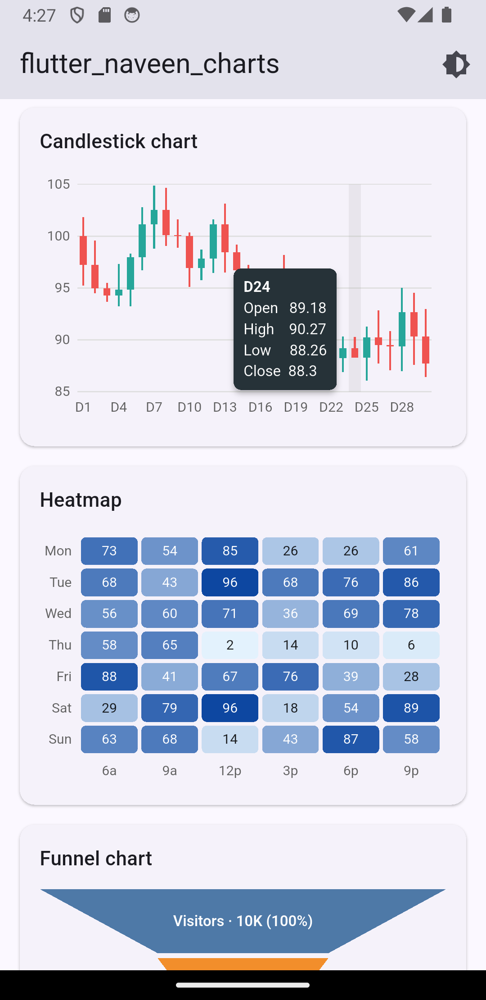
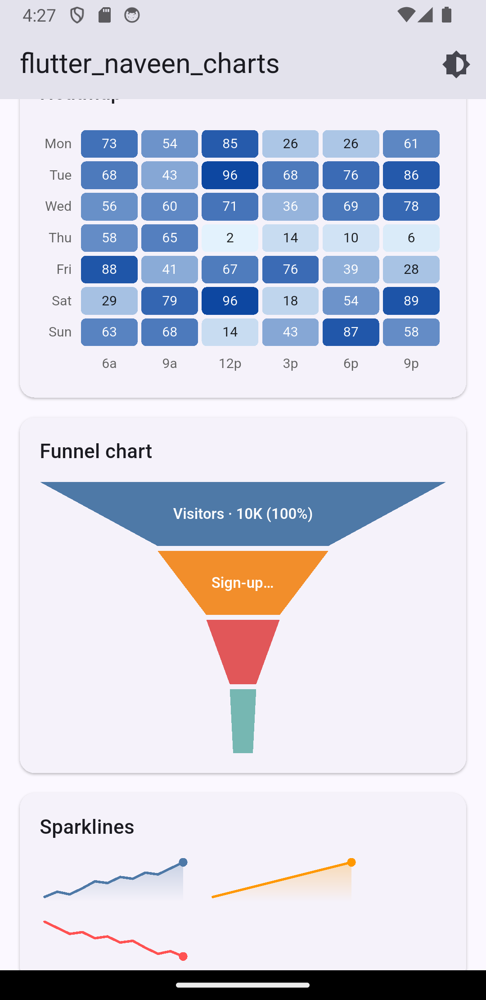
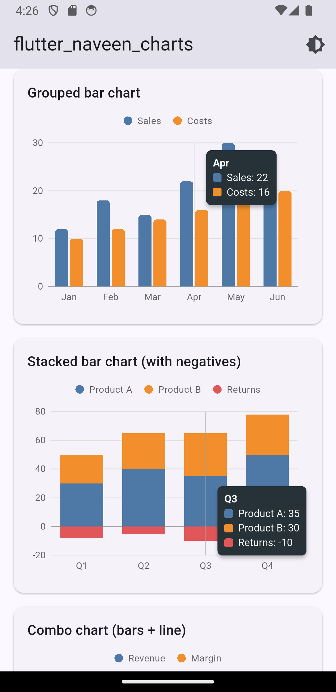

# flutter_naveen_charts

Free charts for Flutter, drawn with `CustomPainter`.
Intro animations, hover / touch tooltips, legends and light/dark themes are built in.

| Chart | Widget |
|---|---|
| Line (curved, stepped, dashed) | `LineChart` + `LineSeries` |
| Area | `AreaChart` + `AreaSeries` |
| Bar (grouped / stacked, negatives) | `BarChart(stacked: …)` + `BarSeries` |
| Combo (bars + lines + scatter) | `CartesianChart` |
| Scatter / Bubble | `ScatterChart` / `BubbleChart` + `ScatterSeries` |
| Histogram | `Histogram(values: …, bins: …)` |
| Pie / Donut | `PieChart` / `DonutChart` |
| Radar | `RadarChart` |
| Gauge | `GaugeChart` |
| Candlestick | `CandlestickChart` |
| Heatmap | `HeatmapChart` |
| Funnel | `FunnelChart` |
| Sparkline | `Sparkline` |


## Quick start


LineChart(
  xLabels: ['Jan', 'Feb', 'Mar', 'Apr'],
  series: [
    LineSeries.fromValues(name: 'Sales', values: [12, 18, 15, 22]),
    LineSeries.fromValues(name: 'Costs', values: [10, 12, 14, 16], dashed: true),
  ],
)

BarChart(stacked: true, xLabels: ['Q1', 'Q2'], series: [
  BarSeries.fromValues(name: 'A', values: [30, 40]),
  BarSeries.fromValues(name: 'B', values: [20, 25]),
])

DonutChart(centerText: '1,240', slices: [PieSlice('Done', 62), PieSlice('Todo', 38)])

GaugeChart(value: 72, unit: '%', segments: [
  GaugeSegment(50, Colors.green), GaugeSegment(80, Colors.orange), GaugeSegment(100, Colors.red),
])
```


Numeric x axes: use `LineSeries(name: 'x', points: [DataPoint(0.5, 3), DataPoint(2.1, 7)])`.
Bubbles: `DataPoint(x, y, size: 40)`.


Screenshots



 
 
   
  
  
  
    
   
    
   
   
   